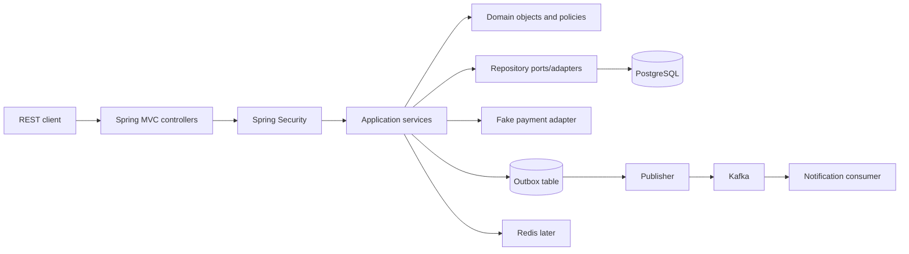

# Architecture & Evolution Plan

## Baseline: Pure Java

`Product`, `Cart`, `Order`, `Stock` domain objects; application orchestration; in-memory repository interfaces; CLI adapter; JUnit tests. No Spring, HTTP or database in stage one.

## Target: Modular monolith

Planned package root `com.orderflow`: `catalog`, `customers`, `cart`, `inventory`, `ordering`, `payment`, `fulfillment`, `identity`, `notification`, `audit`, minimal `shared`.

Each module may contain `api`, `application`, `domain`, `infrastructure` packages. Public module APIs are explicit; do not import another module's internal implementation. Start with simple packages; use Spring Modulith only when modules and tests justify it.

## Responsibility examples

- Controller: translate HTTP request/response, validation boundaries, no domain transaction decisions.
- Application service: coordinate use cases and transactions.
- Domain: invariants and state transition rules independent of transport.
- Repository: persistence abstraction at meaningful boundaries, not redundant wrappers for everything.
- Adapter: translate between internal concepts and third-party/simulator APIs.
- Identity: authorization policy, actor identity, object ownership.

## Checkout transaction (early HTTP version)

Validate request and authenticated customer → resolve server pricing → atomically reserve stock → persist pending order and item-price snapshot → commit. Fake payment is separate from the stock/order DB transaction; handle outcome with explicit transitions and compensation/release. Do not call a slow external API while holding DB locks unnecessarily.

## Consistency experiments

- Parallel requests for the last unit: compare naive read/update vs version checks or conditional SQL update.
- Checkout duplicate: idempotency key bound to customer and normalized request hash.
- Payment duplicate callbacks: deduplicate by provider reference and allowed status transition.
- Outbox: insert record in the same DB transaction; asynchronous publisher; consumer idempotency.
- Cache: catalog only initially; TTL and explicit invalidation after admin change.

## Deployment stages

Local JVM → Docker Compose PostgreSQL → image + CI → safe low-cost hosting → optional multiple instances and performance experiments. Document every infrastructure cost. Avoid paid deployment by default.

## Architectural decisions

Capture alternatives, consequences, and experiment evidence in `DECISIONS.md`. In particular justify Spring MVC before WebFlux; PostgreSQL transactions before messaging; modular monolith before service extraction.
